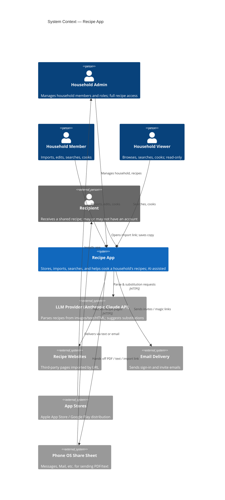
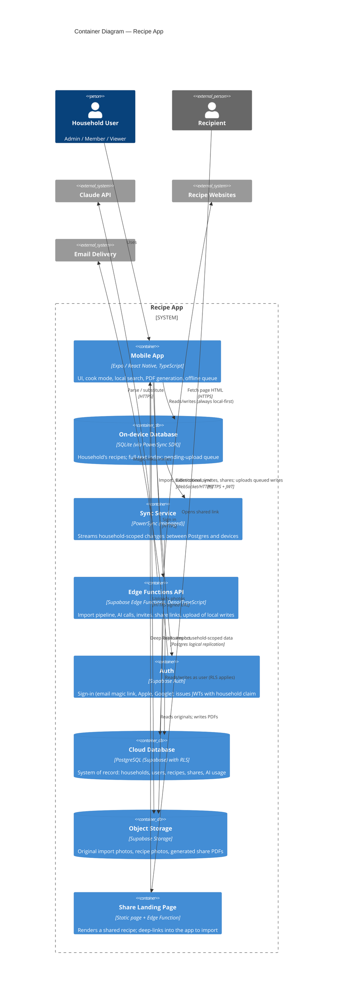
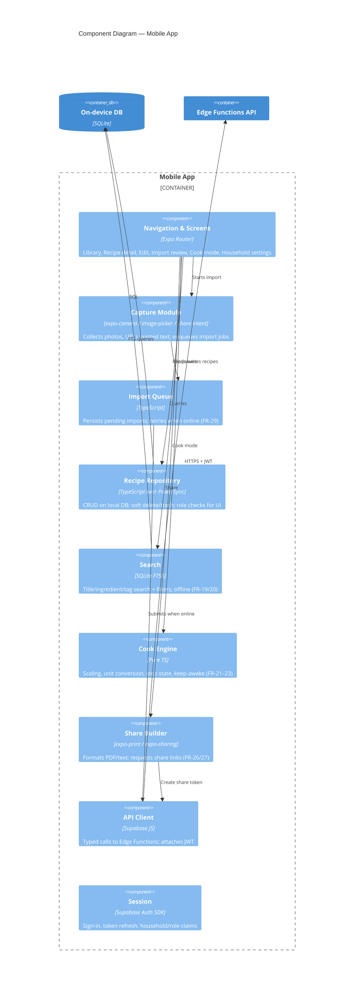
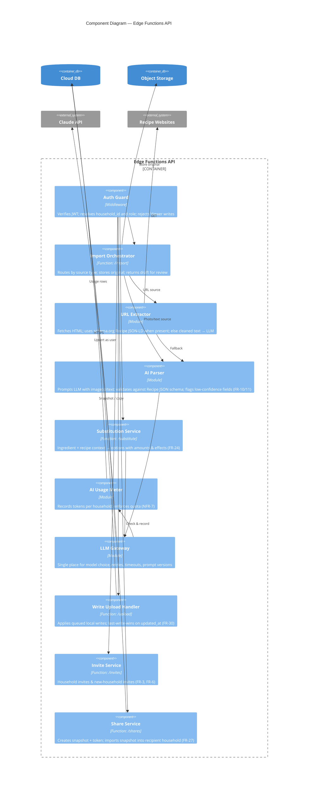
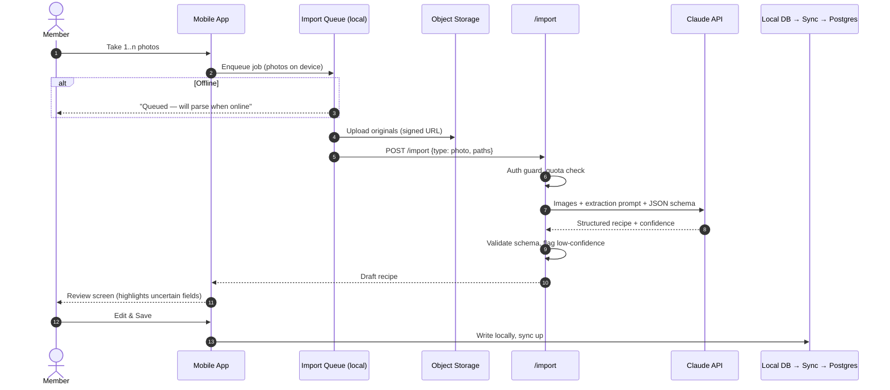
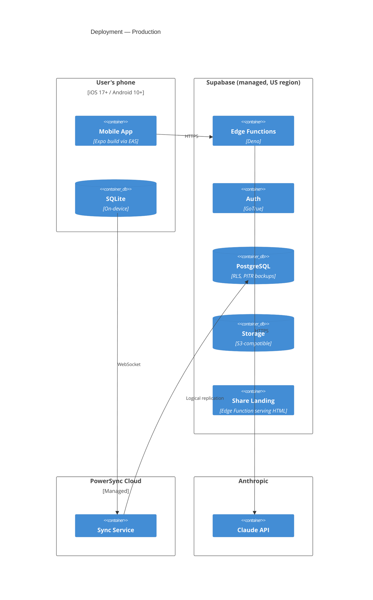
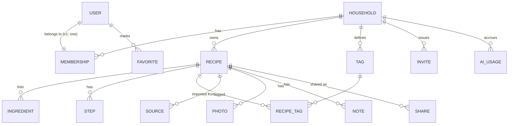

# Architecture

> Status: **Proposed v0.1** · Last updated: 2026-10-12
> Structured per the [C4 model](https://c4model.com): System Context → Containers → Components, plus Dynamic and Deployment diagrams. Level 4 (Code) diagrams are intentionally omitted; the code is the source of truth at that level.
>
> Requirements live in [`docs/SPEC.md`](docs/SPEC.md). Decisions and their trade-offs live in [`docs/adr/`](docs/adr/). Requirement IDs (FR-x, NFR-x) are referenced throughout.

Diagrams use Mermaid's C4 syntax, which GitHub renders natively.

---

## 0. Architectural drivers

The requirements that shape the architecture most:

| Driver | Source | Consequence |
|---|---|---|
| iOS + Android from one codebase, desktop later | Platform decision | Cross-platform framework (ADR-0002) |
| Offline-first: read, search, create, edit with no signal | FR-20, FR-28, NFR-4 | Local database on device is the primary store; cloud is the sync hub (ADR-0004) |
| Household tenancy with strict isolation | §2, NFR-1 | Every row carries `household_id`; isolation enforced by Postgres Row-Level Security (ADR-0006) |
| AI parsing & substitutions, no keys on device | FR-10, FR-24, NFR-3 | AI calls only from a server-side function (ADR-0005) |
| Last save wins | FR-30 | Row-level last-write-wins; no CRDTs |
| Small team, family-scale load, low cost | — | Managed backend (BaaS) over self-hosted services (ADR-0003) |

## 1. Level 1 — System Context

Who uses the system, and what external systems it depends on.

## 2. Level 2 — Containers

The deployable/runnable units inside the Recipe App boundary.

### Container responsibilities

| Container | Owns | Notes |
|---|---|---|
| **Mobile App** | All UI; cook mode; scaling & unit conversion (pure functions, offline); PDF/text rendering for sharing (FR-26); offline import queue (FR-29) | Never holds AI or service-role keys (NFR-3) |
| **On-device DB** | Local copy of the household's data; FTS index for search (FR-19/20) | Writes go here first, then upload queue → API |
| **Sync Service** | Change streaming, per-household sync rules | Sync rules mirror RLS; a device only receives its household's rows |
| **Edge Functions API** | Business logic that must be server-side: import pipeline, AI, invites, share tokens, write validation | Stateless; all functions verify JWT and role |
| **Auth** | Identity; JWT custom claims `household_id`, `role` | Sign in with Apple required on iOS (NFR-12) |
| **Cloud DB** | System of record; RLS on every tenant table | Point-in-time recovery (NFR-9) |
| **Object Storage** | Binary files under `households/{household_id}/...` | Bucket policies mirror RLS |
| **Share Landing Page** | Public, read-only render of a share snapshot | Exposes only the snapshot, never the live recipe (NFR-2) |

## 3. Level 3 — Components

### 3a. Mobile App

### 3b. Edge Functions API

## 4. Dynamic diagram — Import from photo (FR-7, FR-10–12, FR-29)

URL import follows the same flow, with the URL Extractor trying schema.org `Recipe` JSON-LD first and calling the LLM only when structured data is missing or incomplete. That keeps cost down and accuracy up.

## 5. Deployment diagram

**Environments:** `local` (Supabase CLI in Docker + Expo dev client), `staging`, `production`. Each is a separate Supabase project and PowerSync instance. Builds and OTA updates ship through EAS.

## 6. Data model (conceptual)

Conventions for every tenant table:
- `id` as a UUID, generated on the device so it works offline
- `household_id` (NOT NULL, indexed); RLS policy `household_id = auth.jwt() ->> 'household_id'`
- `created_at`, `updated_at`, `updated_by`, `deleted_at` (soft delete → 30-day trash, FR-18)
- Ingredients are stored structured (`quantity`, `unit`, `item`, `prep_note`, `raw_text`) so scaling, search, and the Phase 2 shopping list can use them

`SHARE` stores an immutable JSON **snapshot** of the recipe. Recipients import from the snapshot, never from the sender's live row.

## 7. Cross-cutting concerns

| Concern | Approach | NFR |
|---|---|---|
| **Tenant isolation** | RLS on every table and storage bucket; sync rules scoped by `household_id`; Edge Functions use the user's JWT, never the service role, except in the share-import path, which is audited; an automated test suite tries cross-household reads and writes | NFR-1 |
| **Roles** | `role` claim in the JWT; RLS write policies exclude `viewer`; UI hides edit affordances | FR-4 |
| **Conflicts** | Row-level LWW on `updated_at` (server clock on upload). Ingredients and steps are child rows, saved as a set with the recipe | FR-30 |
| **AI** | All prompts versioned in `supabase/functions/_shared/prompts/`; output validated against a JSON schema; usage metered per household | NFR-3, NFR-7 |
| **Secrets** | Only the Supabase anon key ships in the app. Claude API key and service role key live in Edge Function secrets | NFR-3 |
| **Observability** | Structured logs in Edge Functions; Sentry for app crashes; AI latency/cost dashboard from `ai_usage` | NFR-6, NFR-7 |
| **Backups** | Supabase PITR; household JSON export | NFR-9, NFR-10 |
| **Accessibility** | Dynamic type, screen-reader labels, contrast checks in review | NFR-11 |

## 8. Future evolution

- **Phase 2 shopping list:** new tables (`shopping_list`, `shopping_item`) synced like recipes; ingredient normalization reuses the structured ingredient model.
- **Phase 3 meal planning:** `meal_plan`, `meal_plan_entry` referencing recipes; generates shopping items.
- **Desktop:** Expo/React Native for web or Tauri reusing the TS domain packages; PowerSync has a web SDK.
- **Semantic search:** `pgvector` embeddings server-side, with keyword search kept as the offline fallback.

## 9. Decision log

See [`docs/adr/`](docs/adr/). Current: ADR-0001 through ADR-0006.
