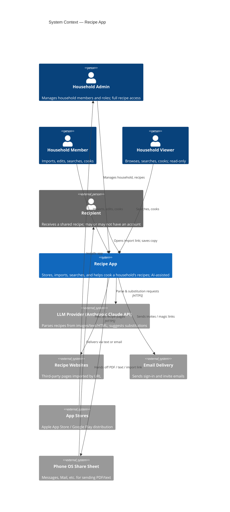
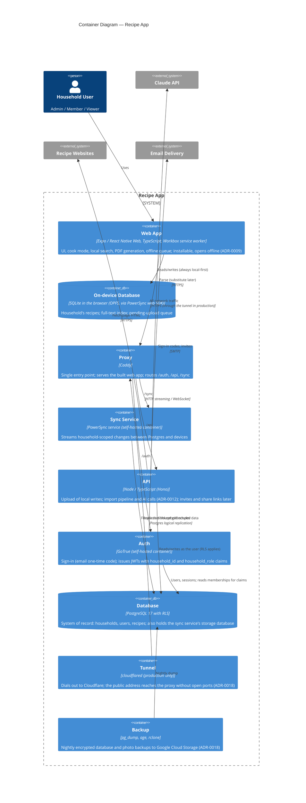
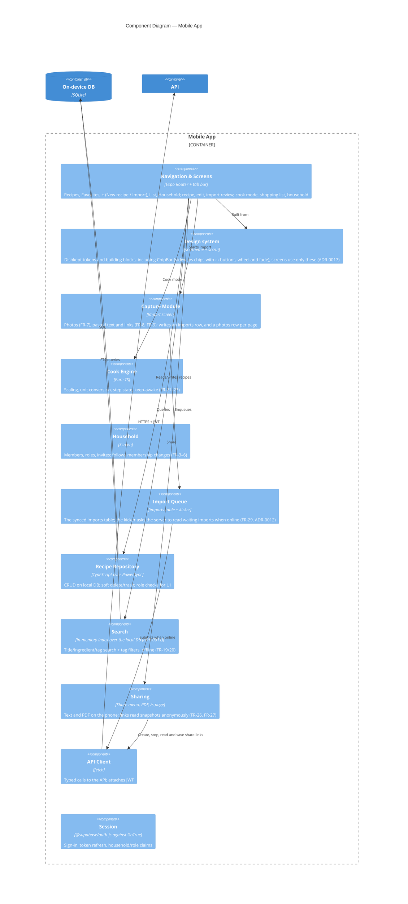
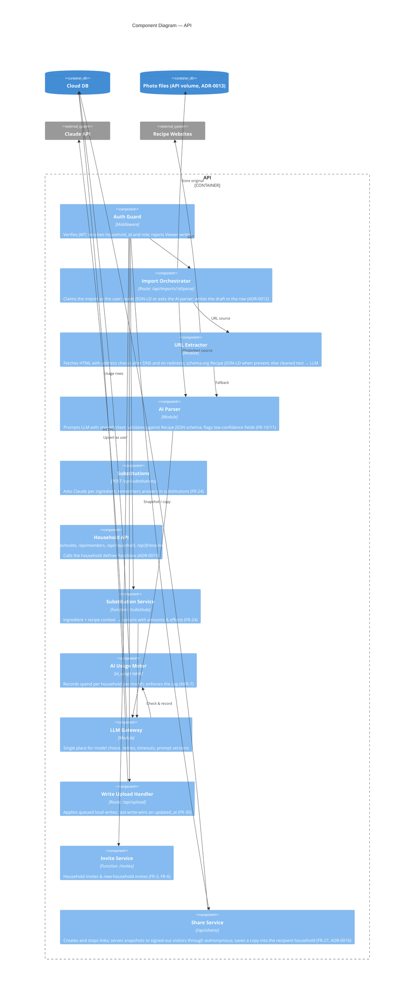
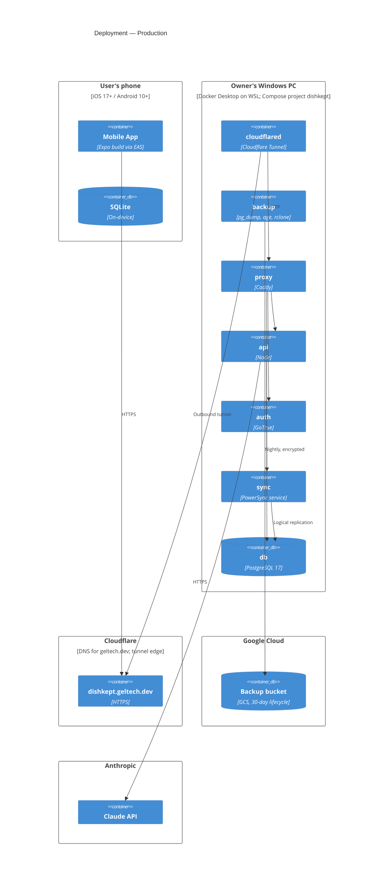
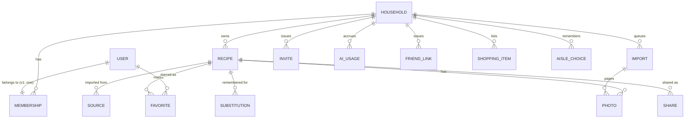

# Architecture

> Status: **Proposed v0.2** · Last updated: 2026-10-17
> Structured per the [C4 model](https://c4model.com): System Context → Containers → Components, plus Dynamic and Deployment diagrams. Level 4 (Code) diagrams are intentionally omitted; the code is the source of truth at that level.
>
> Requirements live in [`docs/SPEC.md`](docs/SPEC.md). Decisions and their trade-offs live in [`docs/adr/`](docs/adr/). Requirement IDs (FR-x, NFR-x) are referenced throughout.

Diagrams use Mermaid's C4 syntax, which GitHub renders natively.

---

## 0. Architectural drivers

The requirements that shape the architecture most:

| Driver | Source | Consequence |
|---|---|---|
| Web first; iOS + Android later from one codebase | Platform decision | Cross-platform framework with a web target (ADR-0002, ADR-0007) |
| Offline-first: read, search, create, edit with no signal | FR-20, FR-28, NFR-4 | Local database on device is the primary store; cloud is the sync hub (ADR-0004) |
| Household tenancy with strict isolation | §2, NFR-1 | Every row carries `household_id`; isolation enforced by Postgres Row-Level Security (ADR-0006) |
| AI parsing & substitutions, no keys on device | FR-10, FR-24, NFR-3 | AI calls only from a server-side function (ADR-0005) |
| Last save wins | FR-30 | Row-level last-write-wins; no CRDTs |
| Small team, family-scale load, lowest fixed cost, portable | — | Our own containers in one Compose stack, self-hosted (ADR-0008) |

## 1. Level 1 — System Context

Who uses the system, and what external systems it depends on.



## 2. Level 2 — Containers

The deployable/runnable units inside the Recipe App boundary.



Photo files live on the API's `photos` volume, served only after an RLS check on their row (ADR-0013); the share landing page (`/s/<code>`) reads a snapshot through `read_share` (ADR-0016).

### Container responsibilities```

### Container responsibilities

| Container | Owns | Notes |
|---|---|---|
| **Mobile App** | All UI; cook mode; scaling & unit conversion (pure functions, offline); PDF/text rendering for sharing (FR-26); offline import queue (FR-29) | Never holds AI or service-role keys (NFR-3); a service worker precaches the app's files so it opens offline (ADR-0009) |
| **On-device DB** | Local copy of the household's data; source for the in-memory search index (FR-19/20, ADR-0011) | Writes go here first, then upload queue → API |
| **Sync Service** | Change streaming, per-household sync rules | Sync rules mirror RLS; a device only receives its household's rows |
| **API** | Business logic that must be server-side: import pipeline, AI, invites, share tokens, write validation | Stateless; verifies the JWT, then runs every statement as the user through asUser |
| **Auth** | Identity; JWT custom claims `household_id`, `household_role` (added by an access-token hook); the sign-up gate (`before_user_created` hook: allowed emails and 24-hour passes from live links, ADR-0018) | Sign in with Apple required on iOS (NFR-12) |
| **Database** | System of record; RLS on every tenant table | Backed up nightly by the Backup container (NFR-9, ADR-0018) |
| **Proxy** | Routing, static web app; TLS locally (Cloudflare terminates it in production) | Only container with a published port in dev; none in production, where the tunnel reaches it |
| **Tunnel** | The public address `dishkept.geltech.dev` | Production only (`docker-compose.prod.yml`, profile `tunnel`); never in a restore drill |
| **Backup** | Nightly `age`-encrypted dump of `app` plus the `photos` volume, uploaded to GCS (30 days), 7 local copies; email on failure; restore and drill | Profile `backup`; connects as `postgres` (operations only); `pnpm test:backup` runs it in CI |

## 3. Level 3 — Components

### 3a. Mobile App



### 3b. API

Only the Auth Guard and Write Upload Handler exist after the walking skeleton.



## 4. Dynamic diagram — Import from photo (FR-7, FR-10–12, FR-29)

```mermaid
sequenceDiagram
  autonumber
  actor U as Member
  participant M as Mobile App
  participant Q as Attachment queue (IndexedDB)
  participant D as Local DB → Sync → Postgres
  participant A as API
  participant V as photos volume
  participant L as Claude API

  U->>M: Take or pick 1–8 pages
  M->>M: Resize to 1568 px, re-encode JPEG
  M->>D: imports row (photo) + a photos row per page
  M->>Q: Keep each file until uploaded
  alt Offline
    M-->>U: "Saved. It'll be read when you're back online."
  end
  D->>A: Rows upload (/api/upload)
  Q->>A: PUT /api/photos/:id per page
  A->>V: Store file, set uploaded_at
  M->>A: POST /api/imports/:id/parse
  A-->>M: 409 photos_pending until every page is uploaded, then 202
  A->>V: Read pages
  A->>L: Pages as images + photo prompt + record_recipe tool
  L-->>A: Draft + low-confidence fields
  A->>D: Validated draft on the import (syncs back)
  M-->>U: Review screen (pages beside the draft)
  U->>M: Save (pages stay as originals; optional dish photo)
```

URL import follows the same flow, with the URL Extractor trying schema.org `Recipe` JSON-LD first and calling the LLM only when structured data is missing or incomplete. That keeps cost down and accuracy up.

## 5. Deployment diagram



**Environments:**
- **Local:** Compose project `recipe-app` with `.env` and the dev profile, which adds a mail catcher; the Expo web dev server, or the built app from the proxy.
- **Production:** project `dishkept` on the owner's PC, using the same Compose file plus `docker-compose.prod.yml` and `.env.production`, run only through `pnpm prod:*`, from a dedicated clone on the Linux disk (`~/dishkept`), never the development checkout. It is reached at `https://dishkept.geltech.dev` through Cloudflare Tunnel (ADR-0018). `scripts/guard.mjs` keeps dev and test commands away from it.
- **Fallback:** a single cloud VM running the same files (ADR-0008); moving is a restore. The steps are in `docs/RUNBOOK.md`.

## 6. Data model (conceptual)



Conventions for every tenant table:
- `id` as a UUID, generated on the device so it works offline
- `household_id` (NOT NULL, indexed); RLS policy `household_id = auth_household_id()`
- `created_at`, `updated_at`, `updated_by`, `deleted_at` (soft delete → 30-day trash, FR-18)
- Ingredients and steps are JSON arrays on the recipe row (ADR-0010), each element with a stable id; ingredients keep the typed line (`raw`) plus parsed `quantity`, `quantity_max`, `unit`, `item`, `note`, so scaling, search, and the Phase 2 shopping list can use them
- Favorites are a per-user table (`favorites`), synced only to that user
- `INVITE` (`invites`): role, sha256 of the link's code, expiry, accepted and cancelled times; read by the household's Admins only and written only by the ADR-0015 functions. Roles are checked live from `memberships`, which syncs to phones (`household_members`, `my_membership`)
- `SHOPPING_ITEM` (`shopping_items`): one row per added ingredient or typed item: `item`, `item_key` (the merge key), scaled `quantity`, `quantity_max`, `unit`, `note`, `aisle`, `recipe_id` and a copied `recipe_title` (no foreign key), `checked_at`. Merged into lines on screen by `shoppingLines` (ADR-0019); cleared rows are purged after 30 days
- `AISLE_CHOICE` (`aisle_choices`): the household's aisle for an `item_key`, unique per household and upserted on it; beats the built-in word list
- `SHARE` (`shares`): `recipe_id`, the validated `snapshot` (with its dish photo's size), sha256 of the link's code, the kept code (`kept_code`, not synced) so Link reuses a live link, `deleted_at` when stopped; read by the household, written only by the ADR-0016 functions; a stopped share and its photo copy go in the 30-day purge
- `PHOTO` (`photos`): `kind` (page or dish), `import_id` and `position` for pages, `recipe_id`, `media_type`, `bytes`, `width`, `height`, `uploaded_at`; the bytes are on the `photos` volume. A recipe's dish photo is `recipes.photo_id` (ADR-0013)

- `FRIEND_LINK` (`friend_links`): sha256 of a `/welcome/<code>` link's code and a 30-day expiry; made by `create_friend_link`, listed to every member of the household, revoked by `revoke_friend_link`, its status read signed out through `friend_link_status`, not synced
- The sign-up gate's `signup_settings`, `signup_allowed` and `signup_passes` hold no household data: RLS on, no policies, no grants, not synced (ADR-0018)

`SHARE` stores an immutable JSON **snapshot** of the recipe. Recipients import from the snapshot, never from the sender's live row.

## 7. Cross-cutting concerns

| Concern | Approach | NFR |
|---|---|---|
| **Tenant isolation** | RLS on every table; the API reaches the database only through asUser, as a role that cannot bypass RLS; sync config scoped by `household_id`; an automated suite tries cross-household reads and writes and checks the roles themselves | NFR-1 |
| **Roles** | `household_role` claim in the JWT; RLS write policies require admin or member; UI hides edit affordances | FR-4 |
| **Conflicts** | Row-level LWW on `updated_at` (server clock on upload). Ingredients and steps are child rows, saved as a set with the recipe | FR-30 |
| **AI** | All prompts versioned in `apps/api/src/llm/prompts/`; output validated against a JSON schema; usage metered per household | NFR-3, NFR-7 |
| **Secrets** | The web app ships no keys. Database passwords, the token signing key, and the Claude API key live in .env on the server | NFR-3 |
| **Observability** | Structured logs in the API; Sentry for app crashes; AI latency/cost dashboard from `ai_usage` | NFR-6, NFR-7 |
| **Backups** | Nightly `age`-encrypted dumps of the database and the `photos` volume to GCS, kept 30 days, by a service account that cannot delete; a monthly restore drill (ADR-0018). Household JSON export later | NFR-9, NFR-10 |
| **Accessibility** | Dynamic type, screen-reader labels, contrast checks in review | NFR-11 |

## 8. Future evolution

- **Phase 2 shopping list (built, ADR-0019):** `shopping_items` and `aisle_choices`, synced like recipes; added rows are merged on screen by item, reusing the structured ingredient model and the unit converter.
- **Phase 3 meal planning:** `meal_plan`, `meal_plan_entry` referencing recipes; generates shopping items.
- **Desktop:** Expo/React Native for web or Tauri reusing the TS domain packages; PowerSync has a web SDK.
- **Semantic search:** `pgvector` embeddings server-side, with keyword search kept as the offline fallback.

## 9. Decision log

See [`docs/adr/`](docs/adr/). Current: ADR-0001 through ADR-0012.
